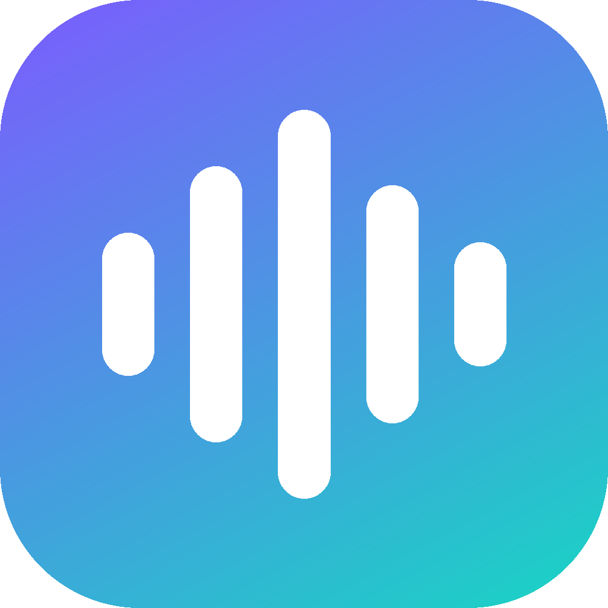
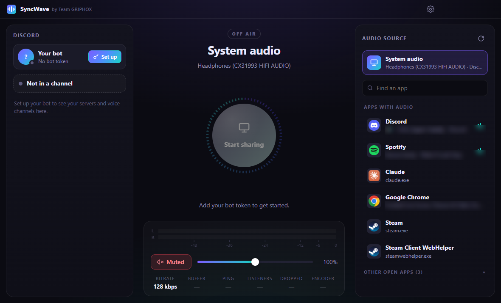
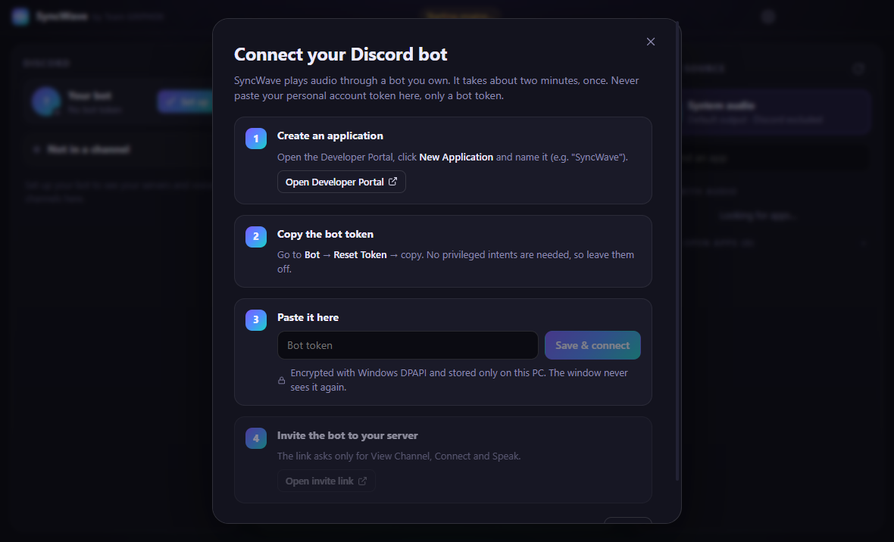
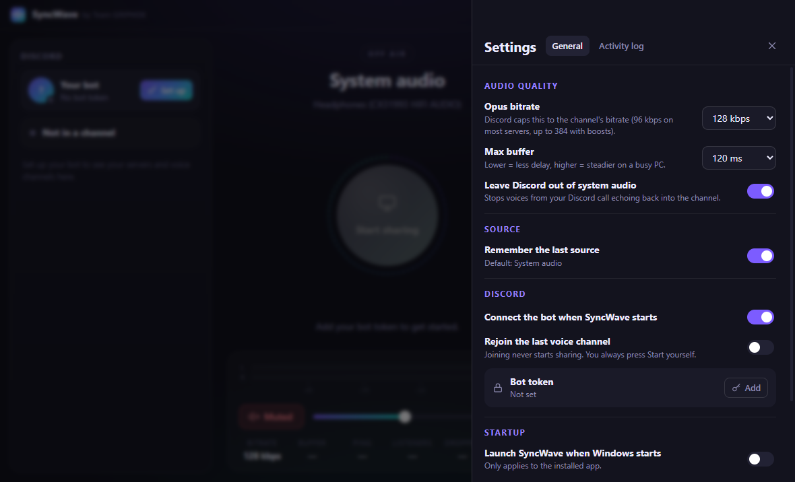
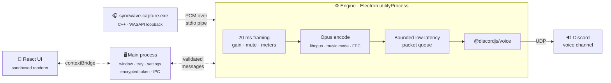

<div align="center">



# SyncWave

### Share your PC's audio, or a single app's audio, into a Discord voice channel through a bot you own.


<p>
  <a href="../../releases"></a>
  
  <a href="LICENSE"></a>
  
</p>
<p>
  
  
  
  
  
  
</p>

<a href="../../releases/latest"></a>

<br/><br/>



<sub>Pick a voice channel on the left and a source on the right, then press the big button.</sub>

</div>

---

## Contents

- [Why SyncWave](#why-syncwave)
- [Features](#features)
- [Quick start](#quick-start)
- [How it works](#how-it-works)
- [Security & privacy](#security--privacy)
- [Build from source](#build-from-source)
- [Tests](#tests)
- [Project status](#project-status)
- [Limitations](#limitations)
- [Roadmap](#roadmap)
- [FAQ](#faq)

## Why SyncWave

Discord's screen share is built for video, and music bots only play links. SyncWave sends **what's actually playing on your PC** (a Spotify playlist, a browser tab, a movie, a game's soundtrack) to your friends in a voice channel, at music quality, with **no user-token tricks**. It runs through a normal Discord bot that you create and own.

## Features

<table>
<tr>
<td width="50%" valign="top">

### 🎧 Audio capture
- **System audio** via WASAPI loopback. It follows you when you switch output devices.
- **One app only** via Windows Process Loopback, including child processes (Chrome, Edge, Electron apps).
- **"Leave Discord out"**, so people in your call don't hear themselves echo back.
- Lists apps with audio and shows which ones are **playing right now**, with real icons and window titles.
- **Switch sources while live.** The bot stays in the channel.

</td>
<td width="50%" valign="top">

### 🤖 Discord
- The bot starts with the app. You never run a separate program.
- Servers and voice channels with **listener counts** and **permission checks**.
- Join, leave, **auto-reconnect with backoff**, follows the bot if someone moves it, and stage channels.
- Only `Guilds` + `GuildVoiceStates` intents. **No privileged intents.**
- The invite link asks only for *View Channel*, *Connect* and *Speak*.

</td>
</tr>
<tr>
<td valign="top">

### 🎚️ Controls
- Start / Stop, **click-free Mute**, volume 0–200 %.
- Stereo peak/RMS meter with peak hold and a live radial visualizer.
- Live stats: bitrate, buffer, ping, listeners, dropped frames, encoder.
- Tray icon with Start / Stop / Mute / Leave, and notifications while hidden.

</td>
<td valign="top">

### ⚙️ Settings that stick
- Opus bitrate and max buffer (latency vs. stability).
- Default or last source, auto-connect, rejoin last channel.
- Launch at login, start minimized, close to tray.
- Built-in **Activity log** for troubleshooting.

</td>
</tr>
</table>

<div align="center">


<br/>
<sub>A guided 4-step bot setup and the settings panel.</sub>
</div>

## Quick start

> [!IMPORTANT]
> You need a Discord bot of your own. It takes about two minutes, once.

1. **Install.** Download `SyncWave-Setup-x.y.z.exe` from [Releases](../../releases) and run it. It's a per-user install with no admin rights needed.
2. **Create a bot.** In the [Discord Developer Portal](https://discord.com/developers/applications), click **New Application** → **Bot** → **Reset Token** → copy it.
   - Leave all **Privileged Gateway Intents off**.
   - Turning **Public Bot off** is recommended, so only you can invite it.
3. **Connect.** Paste the token into SyncWave's setup window → **Save & connect**.
4. **Invite.** Click **Open invite link** and pick your server.
5. **Share.** Choose a voice channel on the left and a source on the right, then press **Start sharing**. 🎶

> [!WARNING]
> **Never paste your personal Discord account token.** SyncWave only accepts bot tokens. Using a user token ("self-bot") is against Discord's Terms of Service.

> [!NOTE]
> The installer is **not code-signed yet**, so Windows SmartScreen may warn you. Click *More info → Run anyway*. Each release lists the installer's **SHA-256**, so you can verify your download (`certutil -hashfile SyncWave-Setup-1.0.0.exe SHA256`).

## How it works

A Discord bot can't hear your PC by itself, so SyncWave builds a real pipeline from the sound card to Discord's voice servers:



**Why anonymous stdio pipes for the audio transport?** They're private to the parent/child pair: no ports, no firewall prompts, back-pressure for free, and no coupling to Electron's native ABI. The engine also keeps latency bounded when the sound card's clock and Discord's 20 ms clock drift apart. The full design is in [docs/ARCHITECTURE.md](docs/ARCHITECTURE.md).

## Security & privacy

| | |
|---|---|
| 🔐 **Token storage** | Encrypted with Electron `safeStorage` (Windows DPAPI, tied to your Windows account) in `%APPDATA%\SyncWave\token.bin`. *Settings → Bot token → Remove* deletes it. |
| 🙈 **Token isolation** | The UI never gets the token back. It reaches the engine only over a private message port, never via command line or environment variables. |
| 🧱 **Sandboxed UI** | The renderer runs sandboxed with `contextIsolation` and no Node.js. Every IPC message is validated. |
| 🎙️ **No microphone** | SyncWave captures playback audio only. It never opens your microphone. |
| ▶️ **You stay in control** | Sharing only starts when you press **Start**. Rejoining a channel never starts sharing on its own. |
| 🚫 **No DRM bypass** | Protected playback and exclusive-mode audio aren't captured, by design. |
| 🧹 **Clean shutdown** | Stopping or quitting tears down capture, encoder and bot. No processes are left behind. |
| 📡 **No telemetry** | SyncWave talks only to Discord. |

## Build from source

<details>
<summary><b>Requirements</b></summary>
<br/>

- Windows 10 2004+ / Windows 11, x64
- Node.js 22+ (tested with 24) and npm 11
- Visual Studio 2019+ Build Tools with **Desktop development with C++** (MSVC + Windows SDK). Only needed to rebuild the native capture helper.
- Python 3, only to regenerate icons (`python scripts/make-icons.py`)

</details>

```bash
npm install
npm run build:native   # builds resources/bin/syncwave-capture.exe
npm run dev            # run with hot reload
npm run dist           # native + app + NSIS installer → release/
```

<details>
<summary><b>Notes on native modules and environment variables</b></summary>
<br/>

`npm install` runs `scripts/fix-opus-binding.cjs`, which makes the N-API libopus binary loadable under Electron. The `allowScripts` field in `package.json` approves the two install scripts npm 11 would otherwise block (`@discordjs/opus`, `electron-winstaller`). If libopus can't load, SyncWave falls back to `opusscript` and says so in *Settings → Activity log*.

No environment variables are needed to run the app. They're only for tests:

| Variable | Purpose |
|---|---|
| `SYNCWAVE_USER_DATA` | Use a throwaway profile folder (the e2e test sets this) |
| `SYNCWAVE_EXE` | Point the e2e test at a packaged `SyncWave.exe` |
| `SYNCWAVE_E2E_NETWORK=1` | Let the e2e test make one login attempt with a fake token |

</details>

<details>
<summary><b>Project layout</b></summary>
<br/>

```
native/capture/      C++ WASAPI helper (list, system/process/exclude loopback)
src/main/            Electron main: lifecycle, tray, IPC, settings, token vault, engine host
src/preload/         contextBridge API (window.syncwave)
src/engine/          utilityProcess: bot, voice, capture, processing, Opus, queue
src/shared/          types, engine protocol, validation
src/renderer/        React UI
tests/unit|native|e2e
docs/ARCHITECTURE.md
```

</details>

## Tests

```bash
npm test               # unit: validation, settings, token vault, framing, gain/mute,
                       #       meters, Opus round-trip, latency queue, stream lifecycle
npm run test:native    # real capture helper on this PC (plays a quiet 440 Hz tone ~3 s)
npm run test:e2e       # builds and drives the real app UI with Playwright
npm run typecheck
```

The native suite includes a **full pipeline test**. It captures a tone-playing process with per-app capture, runs it through framing → gain → libopus → the latency queue → the real `@discordjs/voice` `AudioPlayer`, then decodes the packets the player sends and checks that they contain the tone and keep real-time pace.

## Project status

SyncWave is in **beta**. Here's exactly what has and hasn't been tested so far.

**✅ Verified on Windows 10 Pro (19045)**
- System loopback, per-app loopback and "system minus Discord" capture with real audio levels, continuous 48 kHz output with silence padding, source-exit detection and clean stop.
- The full pipeline capture → Opus → `AudioPlayer`, with packets decoded and checked.
- UI, engine start-up, native libopus and DAVE (Discord voice encryption) loading, IPC validation, settings persistence, malformed-token rejection, Discord's rejection of an invalid token, and clean shutdown with no leftover processes. All of this in dev **and** in the packaged build.

**🧪 Being tested now**
- An end-to-end session with a real bot and real listeners: sound quality, real-world latency, reconnect after network loss, being moved or kicked.
- Running the installer through install and uninstall.

Found a problem? Please [open an issue](../../issues). The *Activity log* in Settings helps a lot.

## Limitations

- Per-app capture needs **Windows 10 version 2004 (build 19041)** or newer.
- DRM-protected playback and exclusive-mode audio can't be captured by loopback.
- If you share **system** audio while you're in the same channel, keep *Leave Discord out of system audio* on to avoid echo.
- Discord caps the effective bitrate at the channel's setting (64–96 kbps on unboosted servers).
- One voice channel at a time. If the engine crashes, it restarts and reconnects the bot, but you have to rejoin the channel.

## Roadmap

- [ ] Code-signed installer
- [ ] Auto-update
- [ ] macOS support. Everything above the capture helper is already platform-neutral, so a port needs a helper with the same stdio protocol (ScreenCaptureKit or Core Audio process taps), an `.icns` icon and an electron-builder `mac` target.
- [ ] Mixing several apps into one stream

## FAQ

<details>
<summary><b>Is this against Discord's rules?</b></summary>
<br/>
No. SyncWave uses an ordinary bot account through Discord's official API and voice protocol, the same way music bots do. It never asks for or uses your personal account token.
</details>

<details>
<summary><b>Why do I need my own bot?</b></summary>
<br/>
The audio has to be sent by someone in the channel, and a bot you own means your token never leaves your PC. There's no shared server in the middle.
</details>

<details>
<summary><b>My friends hear an echo of themselves.</b></summary>
<br/>
You're sharing system audio while you're in the call. Turn on <i>Settings → Leave Discord out of system audio</i>, or share a single app instead.
</details>

<details>
<summary><b>Windows says the installer is unrecognized.</b></summary>
<br/>
This happens because the installer isn't code-signed yet. Compare the SHA-256 shown on the release page, then click <i>More info → Run anyway</i>. You can always build it yourself from source.
</details>

---

<details>
<summary><b>🇸🇦 بالعربية: البدء السريع</b></summary>
<br/>

<div dir="rtl">

1. نزّل المثبّت من [Releases](../../releases) وشغّله.
2. أنشئ بوتاً من [Developer Portal](https://discord.com/developers/applications)، ثم من تبويب **Bot** اضغط **Reset Token** وانسخ التوكن. لا تحتاج إلى أي Intents مميزة.
3. الصق التوكن في نافذة الإعداد، ثم اضغط **Open invite link** وأضف البوت إلى سيرفرك.
4. اختر روماً صوتياً من اليسار، ومصدر الصوت من اليمين (صوت النظام أو تطبيق معيّن)، ثم اضغط **Start sharing**.

لا تضع توكن حسابك الشخصي أبداً، بل توكن البوت فقط. يُخزَّن التوكن مشفّراً على جهازك.

</div>
</details>

<div align="center">
<br/>

Made by **[Team GRIPHOX](https://github.com/GRIPHOX)** · Released under the [MIT License](LICENSE)

<sub>SyncWave is not affiliated with or endorsed by Discord Inc.</sub>

</div>
